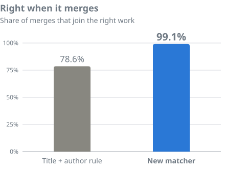
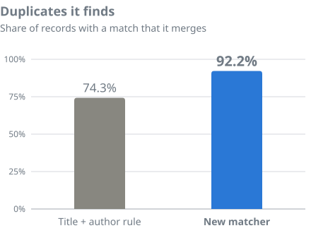

# OpenAlex work matcher

How [OpenAlex](https://openalex.org) decides which work a new record belongs to. Every night, records arrive from Crossref,
DataCite, PubMed and thousands of repositories: a journal article, its preprint, a copy in a university repository, a
catalogue entry. Each one either joins a [work](https://help.openalex.org/data/works/) OpenAlex already has, or becomes a new
work. From the nightly build of **3 November 2026**, this matcher makes that call for every new record. It replaces a rule that bound a record to
the work holding the same normalized title and first author. This is **version 1.0.0**; see the [changelog](CHANGELOG.md).

> **Everything is here:** the code as it runs in production, the models, a tool to run them on your own records, the training
> labels, every test set and every judge's verdict.

## Benchmarks

**The new matcher joins the right work 99.1% of the time, up from 78.6%, and finds 92.2% of the duplicates, up from 74.3%.**

 

**Right when it merges** (precision) is the share of the matcher's merges that join the right work. A wrong merge is the
worse mistake, because it hides a paper inside another one, so the matcher is tuned to be right 99% of the time and leaves a
record as its own work when it is less sure. **Duplicates it finds** (recall) is the share of records that have a match in
OpenAlex that it merges with that match.

**Tested on 20,487 records the models never saw, with 12,618 of the matcher's merges checked one by one.** None of these
records were used in training. The models were trained on a separate 100,000 incoming records and 11,728 older works, whose
candidates Claude Opus 5.5 labelled.

| Test set | Records | Merges checked | Right when it merges | Duplicates it finds |
|---|---:|---:|---:|---:|
| 8 judged nights of real incoming records | 7,974 | 4,182 | 99.1% (98.1–99.7%) | 92.2% |
| Held-out records | 9,154 | 7,392 | 99.04% (98.8–99.2%) | 93.9% |
| Frozen gold set: every candidate labelled, disputes settled by a person | 3,359 | 1,044 | 99.45% (98.8–99.7%) | 94.2% |

**Judged nights:** matched while the matcher ran beside the old rule (scored on the same records), judged by Claude Opus 5.5
with a panel (GPT-6.1 Sol, Claude Fable 5.1) on disputes, under [written rules](benchmarks/README.md#what-right-means).
**Held-out:** kept back from training, but the 0.910 threshold was set on them, so the nights and gold set are the
independent checks. **Gold:** 3,458 records drawn before any model was trained; 3,359 had a work they could join. Ranges:
90% for the nights, 95% for the others.

The held-out row leaves out the copy rule (step 5 below), because its labels name one work per record and can't credit a
merge into a second copy of the same paper; with the rule it reads 98.74% / 94.5%, and every one of the 23 extra merges its
labels call wrong joins another copy of the paper the judge picked.

By source on the judged nights: Crossref 99.2% / 91.0%, DataCite 99.7% / 84.2%, PubMed 97.9% / 94.9%, repositories
99.0% / 93.8%. Every set, how it was drawn, and how we scored: [benchmarks/](benchmarks/).

## How it works

**Identifiers first, then find candidates, rank them, and let a language model decide the close calls.** A record stops at
the first step that decides it.

1. **Identifiers.** A record whose DOI, PMID or arXiv id is already on a work joins it. So does one that declares itself a
   version or preprint of a DOI OpenAlex has (DataCite versions, Crossref preprint links).
2. **Find candidates.** About 13 possible works per record, from six searches: shared identifiers and URLs, an identical
   title, the same first author within two years, a similar title (MinHash), the nearest works by meaning
   ([Qwen3-Embedding-0.6B](https://huggingface.co/Qwen/Qwen3-Embedding-0.6B)), and the work the old rule would have picked.
   94% of true matches are among a record's top 10.
3. **Hard rules.** Matching trusts the record's type: an article never joins a book chapter, a dataset, a dissertation or a
   conference abstract ([104 type pairs](models/type_veto.csv)). Two undeclared Kaggle dataset versions stay apart.
4. **Rank.** A gradient-boosted model (XGBoost, 95 features: title, author, identifier, abstract, venue and page overlap,
   declared relations, the embedding score) scores every candidate. When the best score is under 0.01 the record becomes a
   new work. Most records stop here.
5. **Decide.** A fine-tuned [Qwen3.5-9B](https://huggingface.co/Qwen/Qwen3.5-9B) reads the record and its top 10 candidates
   and says yes or no to each. The record joins a candidate when Qwen is at least 91.0% sure, or when Qwen splits its yes
   between two or three copies of the same paper and together they reach 91.0%. Otherwise it becomes a new work.

There is no review queue: what the matcher decides is what OpenAlex shows. Both models learned from 100,000 incoming records
whose candidates Claude Opus 5.5 labelled ("which of these is the same work, if any?"), plus 11,728 shortlists of older
works. What counts as the same work (a preprint and its published version: yes; a conference abstract and the later article:
no) is in [benchmarks/README.md](benchmarks/README.md#what-right-means) and on
[help.openalex.org](https://help.openalex.org/data/works/matching/).

## Use it

The matcher runs on your own records through the public OpenAlex API: give it a record and it tells you which work OpenAlex
would join it to, or that it would be a new work.

```bash
git clone https://github.com/ourresearch/openalex-work-matcher && cd openalex-work-matcher
pip install -r requirements.txt
python3 tools/download.py qwen-adapter.tar --to assets/
export OPENALEX_API_KEY=...        # free: https://openalex.org/settings/api
python3 scripts/match.py examples/records.jsonl --adapter assets/qwen-adapter > decisions.jsonl
```

A record is one JSON object shaped like an OpenAlex location: `title`, `authors` (`name`, or `given` + `family`, and
`orcid`), `published_date` or `year`, `ids` (`{"namespace": "doi", "id": "10...", "relationship": "self"}`, PMIDs,
declared relations), `type`, `source_name`, `publisher`, `volume`, `issue`, `first_page`, `abstract`, `landing_page_url`,
`pdf_url`, and `provenance` (`crossref`, `datacite`, `pubmed`, `repo`). Every field but the title is optional; the more you
give, the better it matches. See [examples/records.jsonl](examples/records.jsonl).

Steps 1 to 4 run on a laptop. Step 5 needs a GPU with about 24 GB; `--stage1-only` runs everything else and writes Qwen's
prompts for scoring elsewhere. A record takes about eight API calls and, on a laptop, about 13 seconds.

**It gives the answer OpenAlex gives.** Given production's candidates, the tool's features and model scores equal
production's exactly. Searching on its own through the API, on records of the first live night matched as they arrived, it
reached production's decision for 99.5% of them ([details](REPRODUCE.md#run-the-matcher-on-records)). It differs from
production in three ways: it searches the API instead of OpenAlex's own index, so it sees fewer candidates and can miss a
match production finds; the API does not serve some publishers' abstracts; and production skips searching on titles shared
by thousands of works ("Occurrence Download"), which the tool still searches.

To run the matcher the way OpenAlex does, over a whole night of records in Databricks, see [pipeline/](pipeline/).

## Known issues

- **Repository copies sometimes stay separate.** When a repository sends a record of a paper OpenAlex already has, and the
  record is thin (no DOI, a shortened title), the matcher can leave it as its own work. Most of the duplicates it misses
  are of this kind.
- **Short titles** ("Editorial", "Reply") rarely match: found 69.1% for titles of three words or fewer.
- **Types are trusted.** A record with the wrong type (a thesis typed as an article) can be kept apart from its work until
  the type is fixed.
- Records matched before 3 November 2026 keep the matches the old rule made.

Found a wrong merge or a duplicate? [Tell us](https://openalex.org/contact).

## Reproduce it

Every number above recomputes from files in this repository in seconds, with no GPU or key; retraining XGBoost from the
released features gives a byte-identical model. Steps: [REPRODUCE.md](REPRODUCE.md).

## License

Code: [MIT](LICENSE). Data (labels, test sets, verdicts): [CC0](data/LICENSE). Model weights (the XGBoost model and the Qwen
adapter): [Apache 2.0](models/LICENSE), as are the Qwen3.5-9B and Qwen3-Embedding-0.6B base models.
